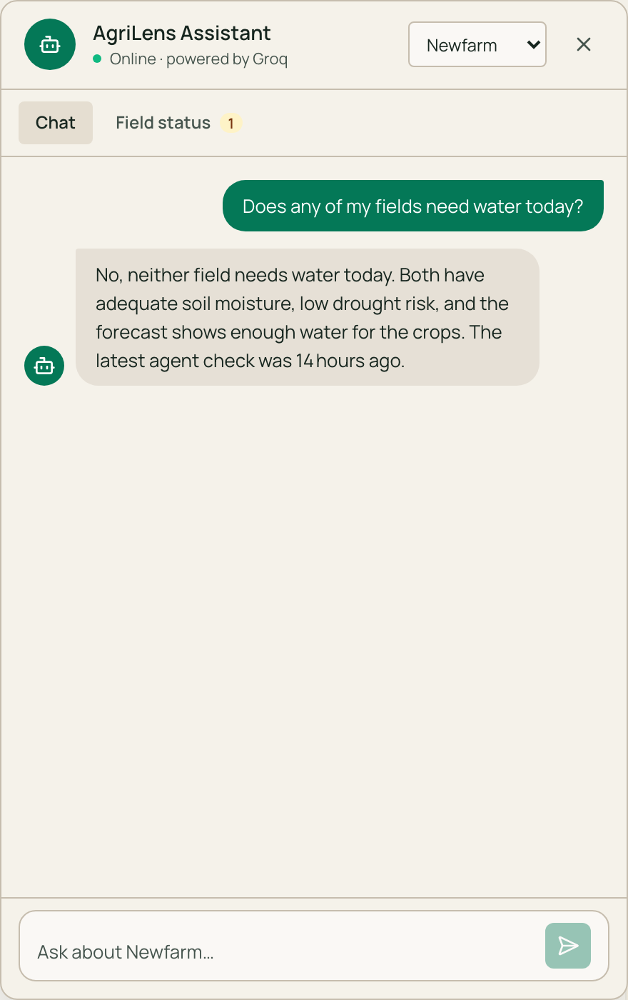
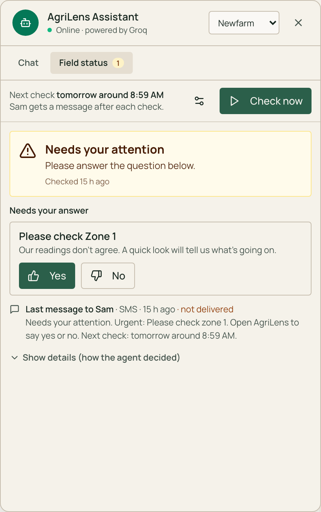
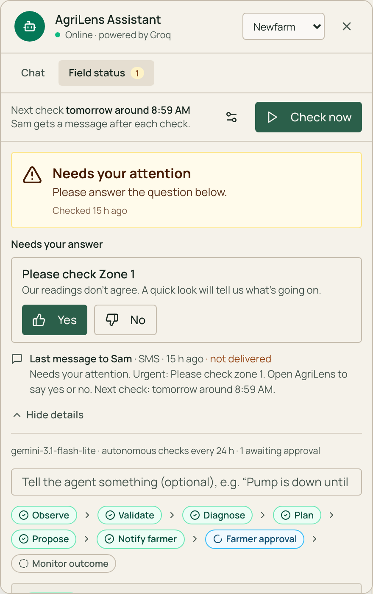

# AgriLens Atlantic: Field Resilience Agent

**AgriLens turns satellite, weather and soil data into one clear answer for each field: how healthy the crop
is, where stress is building, how drought is developing, and when to water.** This repository contains its
agentic AI layer, the **Field Resilience Agent**, which checks every field every day and turns those insights
into action.

*Every drop, justified.*

Submitted to the **Cognizant BrAInstorm Challenge 2026: Agentic AI for Good**.

> **Code preview, all rights reserved.** This repository contains the agentic AI layer of AgriLens
> (the agent, the farmer assistant and the chat). It is shared for evaluation only. The core AgriLens
> analysis engines (crop health and stress, soil moisture, drought risk, weather and irrigation scheduling) are
> proprietary and **not included**. See [LICENSE](LICENSE).

---

## The problem

Prince Edward Island grows about a quarter of Canada's potatoes, and all of its drinking water comes from
groundwater. Yet crop care and irrigation are still decided by eye and by calendar. The data that could help
already exists, but it's buried in satellite imagery, weather models and charts that no farmer has time to read.
A wrong call means a lost crop, or water pumped away from a supply the whole island shares.

## AgriLens

AgriLens turns complex datasets into useful decisions, field by field. A farmer draws a field once, and AgriLens
watches it using satellite imagery, soil-moisture models and live forecasts. It sums everything up in four simple
scores: **moisture, drought risk, crop health and irrigation need**. Detailed views show where the crop is under stress
and whether that stress is spreading or recovering, how fast the soil is drying, and how drought is developing over
time. It covers all of Atlantic Canada and runs on free, open data, so a family farm gets the same intelligence as
the largest operation.

**The Field Resilience Agent** (this repository) is the part that acts on those insights.

## What the agent does

Every day (and whenever the farmer asks), the Field Resilience Agent runs a monitoring cycle for each field:

```
 1. Observe           → field profile, past actions and their outcomes
 2. Validate          → is the evidence fresh? do the sources agree? refresh stale sources
 3. Diagnose          → soil moisture · drought risk · crop health · weather outlook · trends
 4. Plan              → choose an action: irrigate · wait for rain · inspect a zone · collect sensor evidence
 5. Propose           → the safety policy validates every proposal (evidence, confidence, water amount)
 6. Notify farmer     → one plain-language message per check (Telegram or SMS)
 7. Farmer approval   → consequential actions wait for the farmer's Yes/No
 8. Monitor outcome   → after an action, compare the outcome and re-plan
```

Each proposed action carries its **evidence, assumptions, confidence and water requirement**, so the farmer
always sees why the agent is recommending it.

## Screenshots

| Chat | Field status | How the agent decided |
|---|---|---|
|  |  |  |
| Farmers ask in plain words. Answers use live field data through read-only tools. | One status card, one question, the last message sent. | The details view shows each stage of the agent cycle. |

*Contact details in the screenshots are replaced with placeholders.*

## Architecture

```
┌──────────────────────── Frontend (React + TypeScript) ────────────────────────┐
│  AssistantLauncher: Chat tab + Field status tab                                │
│  FieldAgentPanel: status card, Yes/No requests, details on demand              │
└───────────────────────────────┬────────────────────────────────────────────────┘
                                │ REST (/api/agent/*)
┌───────────────────────────────┴──────── Backend (FastAPI, Python) ─────────────┐
│ routes/agent.py                                                               │
│                                                                               │
│ agent/runner.py     LLM tool-use loop  ─┐                                      │
│                     rule-based planner ─┴─→ agent/tools.py ──→ AgriLens engines │
│ agent/policy.py     safety policy shared by both planners          (private)  │
│ agent/evidence.py   freshness and agreement checks                             │
│ agent/outcomes.py   outcome evaluation and re-planning                         │
│ agent/scheduler.py  daily monitoring loop                                      │
│ agent/alerts.py     plain-language farmer messages                             │
│ agent/notifier.py   SMS (Twilio)    agent/telegram.py  Telegram bot + linking  │
│ agent/chat.py       topic-locked farmer chat with read-only tools              │
│ agent/store.py      runs, steps, actions, messages (PostgreSQL)                │
└───────────────────────────────────────────────────────────────────────────────┘
```

### Design choices

- **Additive layer.** The agent wraps existing AgriLens engines as tools. It never changes their pipelines.
- **Multiple AI providers, with fallback.** Gemini, Groq and Claude, set in order by `AGENT_PROVIDER_ORDER` and
  `AI_PROVIDER_ORDER`. If a provider fails or hits a rate limit, the next one takes over within the same request.
- **Works without AI.** A deterministic rule-based planner uses the same tools and the same safety policy,
  so monitoring continues with no API key.
- **The farmer stays in control.** Consequential actions need explicit approval. Every step is logged
  (`agent_runs`, `agent_steps`, `agent_actions`) for auditability.
- **Simple for farmers.** One status card and Yes/No questions by default. The technical trace, evidence and
  policy checks sit behind "Show details".
- **Safe chat.** The assistant only answers farm questions, uses read-only tools, and is rate-limited.

## Agent tools

| Tool | Purpose |
|---|---|
| `get_field_profile` | Field, crop and boundary context |
| `review_past_actions` | What was done before, and how it turned out |
| `check_evidence_freshness` / `refresh_stale_sources` | Data quality gate before deciding |
| `assess_soil_moisture` · `assess_drought_risk` · `assess_crop_health` | Engine assessments |
| `plan_irrigation` · `get_weather_outlook` · `get_recent_trends` | Planning inputs |
| `propose_action` | Proposal validated by the safety policy |
| `finish_run` | Closes the cycle with a summary |

## API (agent endpoints)

| Method | Endpoint | Purpose |
|---|---|---|
| GET | `/api/agent/status` | Provider, mode, monitor and Telegram status |
| POST | `/api/field-reports/{field_id}/agent/runs` | Start a check now |
| GET | `/api/field-reports/{field_id}/agent/runs` · `/api/agent/runs/{run_id}` | Run history and full trace |
| GET | `/api/agent/inbox` | Pending farmer decisions |
| POST | `/api/agent/actions/{id}/decision` · `/complete` · `/evaluate` | Approve or decline, complete, evaluate outcome |
| GET/PUT | `/api/field-reports/{field_id}/agent/settings` | Contact and monitoring settings |
| GET | `/api/field-reports/{field_id}/agent/messages` | Message log |
| POST/DELETE | `/api/field-reports/{field_id}/agent/telegram…` | Link or unlink Telegram |
| POST | `/api/agent/chat` | Farmer assistant chat |

## Repository layout

```
backend/
  agent/              agent code (runner, policy, tools, evidence, alerts, chat, providers…)
  routes/agent.py     FastAPI routes
  alembic/versions/   database migrations for the agent tables
  tests/              unit tests for policy, alerts, chat and provider fallback
  .env.example        configuration keys (no secrets)
  requirements.txt
frontend/
  src/components/assistant/AssistantLauncher.tsx   assistant window (Chat + Field status)
  src/components/agent/FieldAgentPanel.tsx         farmer-facing agent panel
  src/components/agent/fieldAgentApi.ts            typed API client
```

## Tests

35 unit tests cover the parts that must be predictable:

| File | What it checks |
|---|---|
| `test_field_agent_policy.py` (14) | Safety policy: irrigation needs the planner and forecast, water can't exceed the planner or farmer cap, forecast rain or low confidence blocks irrigation, stale moisture forces a refresh, unknown zones are rejected; evidence freshness; outcome judgement |
| `test_field_agent_alerts.py` (13) | Farmer messages: rain, drought, crop health and decision warnings, check status, next check in farm time, plain-text SMS, Telegram formatting, channel choice, phone normalization and masking |
| `test_field_agent_chat.py` (4) | Chat: history capping, rate limit, tools are read-only, Gemini answers when Groq fails |
| `test_field_agent_gemini.py` (4) | Gemini client: schema sanitizing, function declarations, multi-turn tool calls, ignoring thought parts |

They use the standard library `unittest` and run inside the full AgriLens platform:

```bash
python -m unittest tests.test_field_agent_policy tests.test_field_agent_alerts \
                   tests.test_field_agent_chat tests.test_field_agent_gemini
# Ran 35 tests … OK
```

## Not included

The full AgriLens field intelligence platform is proprietary. That covers crop health and stress analysis
(Sentinel-2 via Google Earth Engine), soil moisture detection, drought risk tracking, irrigation scheduling,
weather, Atlantic province coverage, Operations monitoring, and the maps and dashboard.
`agent/tools.py` imports those services by name. This repository is a **code preview** and is not meant to run
on its own.

## Tech stack

Python 3.9 · FastAPI · SQLAlchemy (async) · PostgreSQL/PostGIS · Alembic · httpx ·
Gemini / Groq / Claude APIs · Telegram Bot API · Twilio ·
React · TypeScript · Vite · Tailwind CSS · shadcn/ui

## Team

**AgriLens Atlantic**

---

© 2026 AgriLens Atlantic. All rights reserved.
